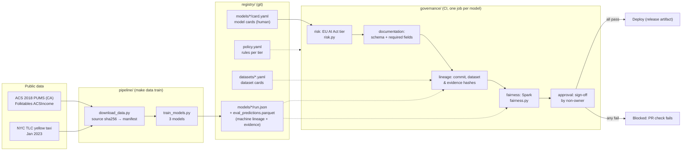
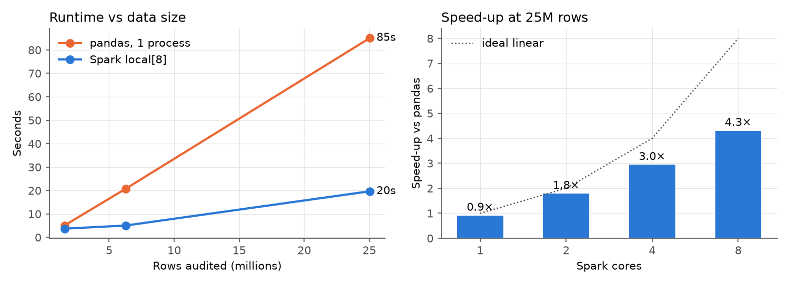

# AI Governance Registry with Deployment Gates

A registry of model and dataset cards in which every model gets an **EU AI Act risk tier** and must pass
**CI deployment gates** for documentation, lineage, fairness and approval before it is released.
The fairness gate is a **Spark job**, and the same code is benchmarked at up to 25 M rows.

| Deliverable | Where |
|---|---|
| Registry (model and dataset cards, schemas, rendered view) | [`registry/`](registry/), [`REGISTRY.md`](REGISTRY.md) |
| CI gate configuration | [`registry/policy.yaml`](registry/policy.yaml) (rules per tier) and [`.github/workflows/governance-gate.yml`](.github/workflows/governance-gate.yml) |
| Three example models that pass or fail | [`registry/models/`](registry/models/): `income-fair` ✅, `income-baseline` ❌, `taxi-eta` ❌ |
| Reproducible pipeline | [`Makefile`](Makefile), [`pipeline/`](pipeline/) |
| Results notebook | [`notebooks/results.ipynb`](notebooks/results.ipynb) |
| Technical report | [`report/report.pdf`](report/report.pdf) (source: [`report/report.md`](report/report.md)) |
| 3-minute demo video | [`demo/demo.mp4`](demo/demo.mp4) (narration: [`demo/script.md`](demo/script.md)) |
| Model card / data card | [`registry/models/income-fair/card.yaml`](registry/models/income-fair/card.yaml), [`registry/datasets/acs-income-ca-2018.yaml`](registry/datasets/acs-income-ca-2018.yaml) |

## Architecture



How the gates work:

| Gate | Blocks when | Applies to |
|---|---|---|
| **risk** | The tier computed from `risk.use_case` (Art. 5 / Annex III / Art. 50) differs from `declared_tier`, or the tier is `unacceptable` | all |
| **documentation** | The card fails its JSON Schema, or a field required for its tier is missing | all (more fields for high risk) |
| **lineage** | No `run.json`; the training commit is missing from git or the tree was dirty; a training dataset is unregistered, or its sha256 differs from its card; the evaluation evidence was altered after training | all |
| **fairness** | Recomputed with Spark from the evidence file: disparate impact < 0.8, or TPR gap > 0.1, on any sensitive attribute | high risk |
| **approval** | Not `approved`, or the approver is the owner | high risk |

## Results

| Model | Tier | Gate decision | Why |
|---|---|---|---|
| `income-fair` | high (Annex III 5(b), credit) | ✅ **DEPLOY** | Accuracy 0.747; race disparate impact 0.885; sex disparate impact 0.977 |
| `income-baseline` | high (Annex III 5(b), credit) | ❌ **BLOCKED** (fairness) | Accuracy 0.825, but race disparate impact 0.299 and TPR gap 0.331, even though SEX and race are not inputs and a human approved it |
| `taxi-eta` | minimal | ❌ **BLOCKED** (documentation, lineage) | No `limitations` (an unofficial `known_issues` field instead); its training dataset's card has no privacy (`personal_data`) statement yet |

The full report is in [`REGISTRY.md`](REGISTRY.md).

**Scaling of the fairness audit** (`make benchmark`, M4 laptop, 25 M rows, identical results on every engine):

| | pandas (1 process) | Spark, 1 core | Spark, 2 cores | Spark, 4 cores | Spark, 8 cores |
|---|---|---|---|---|---|
| Seconds | 85.1 | 92.0 | 47.2 | 28.8 | **19.7** |
| Speed-up vs pandas | 1× | 0.9× | 1.8× | 3.0× | **4.3×** |



The CI gate itself takes 4.6–6.2 s per high-risk model, Spark start-up included.

> **The CI workflow is red on purpose.** Two of the three example models exist to be blocked. Each model has its own
> check, `gate (<model>)`: `gate (income-fair)` is green, and the other two fail with their reasons in the job summary.

## Setup

Requirements: Python 3.12, [uv](https://docs.astral.sh/uv/), Java 17 (for Spark) and about 2 GB of free disk.

```bash
make setup       # uv sync --python 3.12
make data        # downloads ~115 MB: ACS 2018 California + NYC TLC Jan 2023
make train       # ~3 min; commit your code first, because lineage records the git commit
make gate        # runs all gates, rewrites REGISTRY.md, exits 1 if a model is blocked
make test
make benchmark   # Spark vs pandas scaling, ~15 min, writes results/
make notebook    # executes notebooks/results.ipynb
make report      # report/report.md -> report/report.pdf (needs Google Chrome)
```

To gate a single model: `uv run python -m governance.gate income-fair`.

**Live demo app:** `uv run python -m demo.app` opens a local web page where you can try the loan AI on an applicant, run the fairness audit, submit models to the checkpoint (and break them to see them get blocked), and run the 1.6 M-row Spark audit. It needs `make data train benchmark` to have been run first.

**To register a new model:**
1. Add `registry/models/<id>/card.yaml`.
2. Add a dataset card for each new dataset in `registry/datasets/`.
3. Have the training pipeline write `run.json` and `eval_predictions.parquet`.
4. Open a PR; CI picks the model up automatically.

To make the gates actually block merges, mark the `gate (…)` checks as *required* under the repository's branch protection settings.

## Data and ethics

Only public data is used:
- **ACS PUMS:** US Census Bureau, public domain. De-identified microdata, used through the Folktables ACSIncome task.
- **NYC TLC trip records:** NYC open data.

No attempt is made to re-identify anyone. All owner and approver identities are fictional (`@example.org`).
