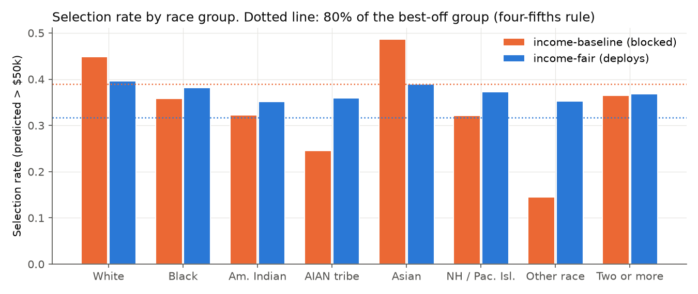
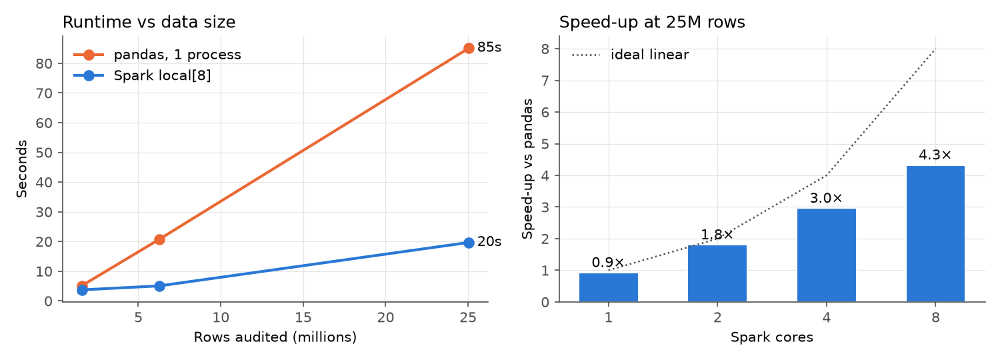

# AI Governance Registry with Deployment Gates

Big Data Systems &amp; Responsible AI Engineering, Topic 32 · Technical report · Code: <code>README.md</code> in the repository

## 1. Problem

A company wants every model documented, risk-rated and approved before release. In practice these checks happen in review meetings and spreadsheets, so they get skipped, and the paperwork drifts away from what was actually trained. We put the policy into code: a version-controlled registry of model and dataset cards, a risk classification based on the EU AI Act (Regulation (EU) 2024/1689), and CI checks that block a model's deployment when its documentation, lineage, fairness or approval requirements are not met. Two principles shape the design.

First, the gate verifies instead of trusting. It computes the risk tier from the use case rather than accepting the tier a team declares. It recomputes fairness from prediction evidence rather than reading it from a card, and it checks lineage against hashes that the training pipeline recorded.

Second, the fairness gate is a big data job. It is written once in Spark, so the same check that runs on a 39 k-row hold-out set in CI can audit tens of millions of rows without changes.

## 2. Architecture

The registry is a set of plain files in git. Git history is the audit trail, and every change to a card goes through a pull request.

| Artefact | Written by | Content |
|---|---|---|
| `registry/models/<id>/card.yaml` | model owner | purpose, users, out-of-scope uses, risk answers, limitations, ethics, human oversight, approval |
| `registry/models/<id>/run.json` | training pipeline | git commit and dirty flag, sha256 of each training dataset, artifact sha256, metrics |
| `registry/models/<id>/eval_predictions.parquet` | training pipeline | `y_true`, `y_pred` and the sensitive attributes on the hold-out set: the fairness evidence |
| `registry/datasets/<id>.yaml` | data steward | datasheet: source URL, licence, source sha256, collection, personal-data statement, known biases |
| `registry/schemas/*.json` | governance team | JSON Schema per card type; `additionalProperties: false` catches unofficial fields |
| `registry/policy.yaml` | governance team | required fields, fairness thresholds and approval rule per risk tier |

`python -m governance.gate [model]` evaluates five gates and exits non-zero if any of them fails. The GitHub Actions workflow runs it as a matrix with one job per model, so each model has its own status check. Each job writes its Markdown report to the job summary and publishes a release artifact only when every gate passes. Branch protection on `main` makes the checks `tests` and `gate (income-fair)` required, so a pull request that breaks the deployed model cannot be merged.

## 3. Risk classification (EU AI Act)

Each card answers a short questionnaire (`risk.use_case`, `interacts_with_people`, `generates_synthetic_content`), and `governance/risk.py` maps the answers to a tier:

| Tier | Trigger | Examples of `use_case` | Consequence in `policy.yaml` |
|---|---|---|---|
| Unacceptable | Art. 5(1)(a) to (h) prohibited practices | `social_scoring`, `predictive_policing_profiling`, `untargeted_facial_scraping` | never deployable |
| High | Art. 6(1) Annex I safety components; Art. 6(2) Annex III areas 1 to 8 | `creditworthiness` (5(b)), `employment` (4), `education` (3) | 6 extra documentation fields (Arts. 9, 10, 13, 14, 15), fairness gate, independent approval |
| Limited | Art. 50 transparency | chatbot, synthetic content | `transparency_notice` required |
| Minimal | none of the above | `other` | base documentation and lineage only |

The card also states a `declared_tier`. If it disagrees with the computed tier, the gate blocks the model, so a team cannot label a credit model "minimal" to avoid its obligations. For reference, the gates map onto the NIST AI RMF: the registry covers GOVERN 1.6 (AI system inventory), intended-use documentation covers MAP 1.1, the fairness gate covers MEASURE 2.11, and the deploy or block decision covers MANAGE 1.1.

## 4. Gates

The documentation gate validates the card against its schema and checks the policy's required fields for the computed tier. Empty strings and empty lists count as missing.

The lineage gate requires a `run.json`. The training commit must exist in the repository, and the working tree must have been clean at training time. Every training dataset needs a registered card whose `source.sha256` matches the hash recorded at training, and that dataset card must pass its own schema and required fields. Finally, the sha256 of the evidence file must be unchanged since training, which catches edited predictions. The hashes are taken of the immutable source files, so a re-run on another machine reproduces them.

The fairness gate applies to the high tier. One Spark scan (`groupBy(attributes)` with count, selected, positives and true positives) gives confusion counts per group, and the gate derives two metrics for each sensitive attribute: the disparate impact ratio (minimum over maximum selection rate), which must be at least 0.8 under the four-fifths rule, and the equal-opportunity gap (maximum minus minimum TPR), which must be at most 0.1. Groups with fewer than 100 rows, or fewer than 100 positives for the TPR, are reported but not gated, because their rates are too noisy. A unit test checks both metrics against fairlearn.

The approval gate also applies to the high tier. The status must be `approved` and the approver must not be the owner (separation of duties).

## 5. Experiment: three example models

We use the Folktables ACSIncome task on the 2018 ACS 1-year PUMS for California: 195,665 people, the label "income > USD 50 k", and the sensitive attributes SEX and RAC1P. We did not use the national file because of download bandwidth. An 80/20 stratified split leaves a hold-out set of 39,133 people. The minimal-risk model uses NYC TLC yellow-taxi trips for January 2023 (3.07 M trips, 600 k sampled).

In the scenario, a fictional lender uses an income pre-screen to order credit applications for review, which is high risk under Annex III 5(b). There are three models:

- `income-baseline` is a HistGradientBoosting classifier with SEX and RAC1P removed from the inputs ("fairness through unawareness"). A human reviewer approved it.
- `income-fair` uses the same inputs but is trained with fairlearn's ExponentiatedGradient under a demographic-parity constraint on SEX × RAC1P (bound 0.01).
- `taxi-eta` is a trip-duration regressor (minimal risk) whose team skipped parts of the documentation.

| Model | Accuracy | DI SEX | DI RAC1P | TPR gap SEX | TPR gap RAC1P | Gate |
|---|---|---|---|---|---|---|
| `income-baseline` | 0.825 | 0.802 | 0.299 | 0.015 | 0.331 | ❌ fairness |
| `income-fair` | 0.747 | 0.977 | 0.885 | 0.075 | 0.054 | ✅ deploy |
| `taxi-eta` | MAE 2.82 min | n/a | n/a | n/a | n/a | ❌ documentation, lineage |

Removing the protected attributes did not remove the disparity. Through proxies such as occupation, place of birth and hours worked, the baseline selects the "Some other race" group at 0.146, against 0.487 for Asian respondents. A human approver signed the model off, and the automated gate still blocked it.

The constraint closes the gap at a price. It brings every gated group into a selection-rate band of 0.35 to 0.40 and roughly halves the TPR gap, but it costs 7.8 accuracy points. The gate makes that trade-off explicit and puts it on record.

`taxi-eta` is blocked for process reasons, not model quality. Its card has an unofficial `known_issues` field instead of `limitations` (a schema error plus a missing field), and the card for its training data still lacks a privacy (`personal_data`) statement. Fairness and approval do not apply at its tier, which shows the requirements scaling with risk.

The tamper test in `tests/test_governance.py` rewrites `income-fair`'s predictions after training, and the lineage gate fails as expected.

## 6. Big data: scaling the fairness audit

`pipeline/benchmark_spark.py` replicates the California data with new person ids at ×8, ×32 and ×128, giving 1.57 M, 6.26 M and 25.0 M rows (16, 64 and 254 MB of Parquet). Spark scores each row with the `income-baseline` model through `mapInPandas`, and the gate's own `group_counts` and `metrics` code computes fairness. The baseline is the same pipeline in single-process pandas. Each worker uses one BLAS/OpenMP thread, so the core count means what it says, and each timing is the best of two runs with JVM start-up excluded.

Every engine and scale reports the same race disparate impact, 0.2938. It differs from the 0.299 in §5 only because this audit covers the full dataset, not just the hold-out set.

| Rows | pandas (1 core) | Spark local[1] | local[2] | local[4] | local[8] | Spark rows/s (8 cores) |
|---|---|---|---|---|---|---|
| 1.57 M | 5.1 s | | | | 3.7 s | 0.42 M |
| 6.26 M | 20.7 s | | | | 5.1 s | 1.24 M |
| 25.0 M | 85.1 s | 92.0 s | 47.2 s | 28.8 s | 19.7 s | 1.27 M |

pandas scales linearly at about 0.3 M rows/s and needs the whole table in memory (1.8 GB of process memory at 25 M rows). On one core, Spark is 8% slower than pandas, which is the cost of the Arrow round-trip. With more cores it reaches 1.8× on 2 cores, 3.0× on 4 and 4.3× on 8 (4.7× against Spark's own single core). Scaling flattens beyond 4 cores because the M4 has 4 performance cores and 6 efficiency cores. At 1.6 M rows, per-job overhead dominates, and throughput only levels off above about 6 M rows.

The gate is cheap in CI: 6.2 s for `income-fair` and 4.6 s for `income-baseline` of wall-clock time including Spark start-up, and 0.1 s for `taxi-eta`, because minimal-risk models never start Spark. Since the gate is a single aggregation over Arrow batches, it streams its input instead of loading it all at once. The same code could audit production prediction logs on a cluster, which a pandas gate cannot do once the logs exceed memory.

## 7. Limitations

Spark ran in local mode on one 10-core laptop (M4, 16 GB). The code runs unchanged with `--master spark://…`, but we did not measure a multi-node cluster.

The large datasets are California data replicated with new ids, so they test throughput, not new statistical content. The models are trained and validated on one state and one year only.

The risk questionnaire is self-reported. The gate catches answers that contradict each other, not dishonest ones, so a governance reviewer still owns the questionnaire. The EU AI Act mapping is a simplified encoding of Art. 5, Art. 6/Annex III and Art. 50, not legal advice, and it does not model Art. 6(3) exemptions or the obligations for general-purpose AI.

The fairness checks are narrow: group metrics on two attributes with fixed thresholds. Intersectional groups appear in the counts but are not gated, and demographic parity and equal opportunity can conflict in general.

Approval is a YAML field. A production set-up would also require a CODEOWNERS review by the governance team, or a protected GitHub Environment. Finally, the constrained model is a randomized ExponentiatedGradient ensemble, so scoring the same person twice can give different answers.

## 8. Ethics statement

All data is public. ACS PUMS is public-domain microdata from the US Census Bureau, de-identified with disclosure avoidance, and we made no attempt at re-identification. The NYC TLC trip records are NYC open data and contain no rider identities.

Race is special-category data under GDPR Art. 9. We use it only to measure and correct bias, in the spirit of EU AI Act Art. 10(5), and never as a model input. The credit scenario, the teams and the approver identities are fictional. Passing these gates does not make a model fair: the gates set a minimum standard that can be audited, and they do not replace domain review or input from the affected communities.
